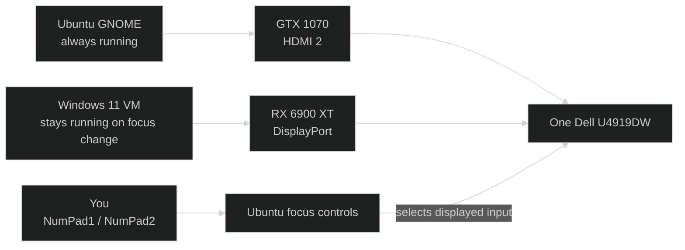
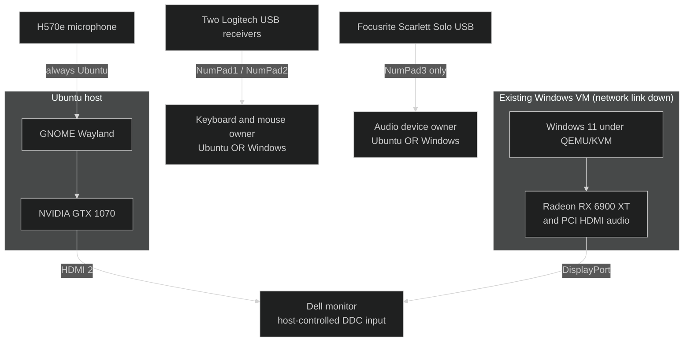
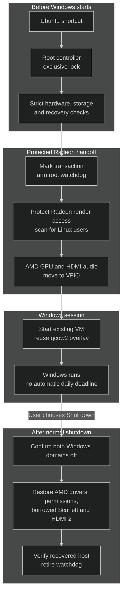
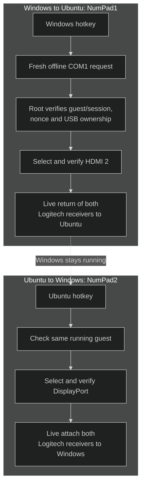
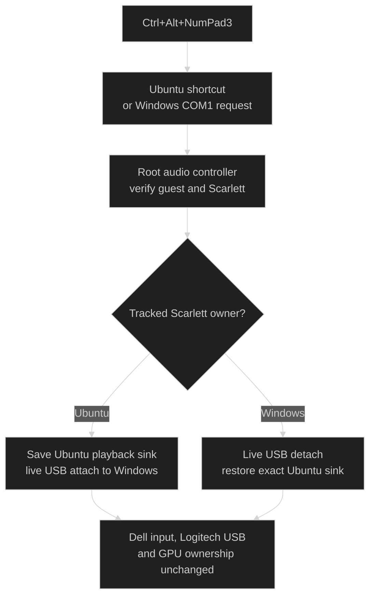
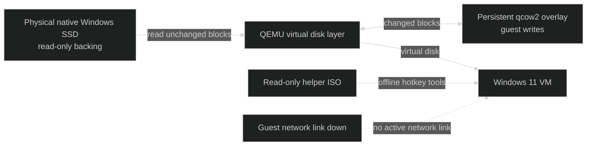
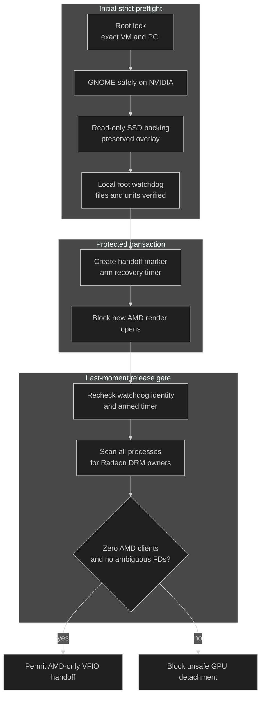
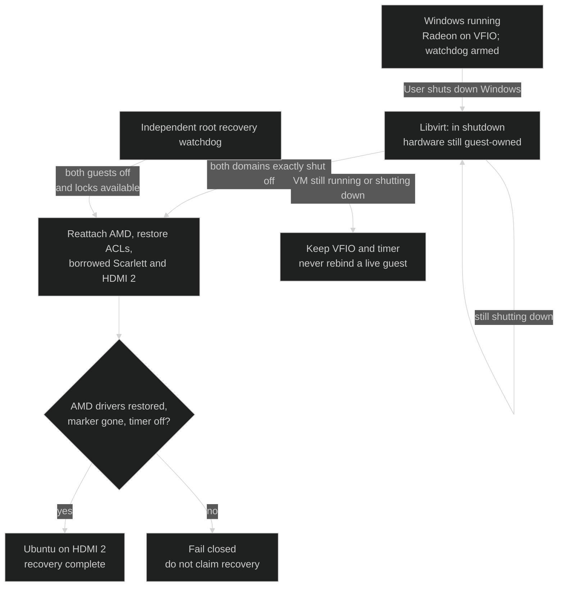

# Ubuntu / Windows 11 dual-GPU passthrough: actual build record

**Status (2026-10-13):** this is the documented result of a working installation on one Ubuntu workstation, **not** an automated installer or reproducible deployment recipe. No GitHub Actions or setup automation is part of this repository.

## Preserved old repository

The earlier Ubuntu 19.10 / Windows 10 GPU passthrough tutorial, old screenshots, XML, and full Git history are unchanged on [archive/legacy-gpu-passthrough-2020](https://github.com/k-spit/gpu-passthrough/tree/archive/legacy-gpu-passthrough-2020), original commit `2f739b9c91d4e3532d6a5762c027ea04f2144551`. The preexisting `focus_feature` branch is untouched. The old 2020 VFIO device IDs, second-NVIDIA-GPU procedure, and initramfs hook are *not* the current setup.

## Current result

The NVIDIA GTX 1070 permanently owns Ubuntu's GNOME Wayland desktop on **Dell U4919DW HDMI 2**. The AMD RX 6900 XT plus HDMI audio is switched to an **offline** Windows 11 libvirt guest shown on the same Dell's **DisplayPort**. GNOME, Chromium, and Chat On Steroids keep running. Windows changes persist in a qcow2 copy-on-write overlay backed by a **read-only** physical Windows SSD.

With NumLock enabled:

| Hotkey | What happens |
| --- | --- |
| `Ctrl+Alt+NumPad1` | Display Ubuntu on HDMI 2 and return Logitech keyboard/mouse; **Windows stays running**. |
| `Ctrl+Alt+NumPad2` | Start/focus Windows on DP; transfer Logitech keyboard/mouse. |
| `Ctrl+Alt+NumPad3` | Independently toggle **Focusrite Scarlett Solo** USB audio between Ubuntu (initial owner) and a running Windows VM. |

**Audio does not follow screen focus.** Ubuntu music or Discord may continue while Windows is shown. The separate H570e microphone remains with Ubuntu. The correct Focusrite Windows audio driver was needed to eliminate crackling.

## How the two desktops work

These diagrams explain the existing **Option A** installation, from the visible desktop switch down to the safety checks. They document the current machine; they are **not** installation or deployment instructions.

### One monitor, two desktops

This diagram shows how one Dell screen can display either Ubuntu or Windows without shutting down the other desktop.

The Dell shows one video source at a time. Returning to Ubuntu does **not** stop Windows, and normal switching never restarts GNOME.

### Which hardware belongs to which system

This diagram shows the fixed graphics connections alongside the two separately controlled groups of USB devices.

Ubuntu's NVIDIA graphics connection stays in place, while the Radeon GPU and its PCI audio move together for Windows. Logitech input and Scarlett audio each have their own USB switching path; the H570e microphone stays on Ubuntu.

### How a normal Windows session starts and ends

This diagram follows the daily launcher through checks, the protected GPU handoff, user-controlled Windows operation, and host recovery.

The root controller moves **only** the AMD PCI functions into Windows, after checking that Ubuntu can safely release them. Windows stays up until the user shuts it down normally; the protected recovery process then restores the host.

### How live screen and keyboard switching works

This diagram follows both focus shortcuts while the **same** Windows VM continues running on its Radeon GPU.

The Windows-to-Ubuntu request is checked by the Ubuntu root watcher; Dell Display Manager is **not** required. A monitor input change alone does not authorize moving USB input. If Windows is off, Ubuntu's NumPad2 instead requests the guarded daily startup shown above.

### How Scarlett audio switches independently

This diagram shows the separate NumPad3 path for moving the **whole** Scarlett USB interface without moving video or keyboard focus.

NumPad3 requires an **already-running** Windows guest and never launches one. Scarlett playback and its own recording inputs move together, while the H570e microphone remains on Ubuntu. NumPad1 and NumPad2 never automatically move Scarlett.

### Where persistent Windows changes are stored

This diagram shows how the VM reads the existing native Windows disk but writes guest changes into a separate persistent overlay.

Windows updates and driver installations persist in the qcow2 overlay, **not** on the physical native SSD. The overlay depends on that backing disk remaining unchanged: booting native Windows and modifying it while reusing the overlay is unsafe.

### What must pass before Radeon can be detached

This diagram shows the repeated watchdog-readiness checks and the final scan for Linux processes still using the AMD graphics device.

Any failed identity, storage, watchdog, or device-ownership check blocks the handoff rather than guessing. The current safety gate uses a **verified local root recovery watchdog**, not the retired Fedora SSH server; this watchdog does not provide remote rescue if the whole Ubuntu host fails.

### How shutdown and root recovery avoid unsafe GPU reuse

This diagram follows the guest states that determine when Linux is allowed to reclaim Radeon and declare the recovery finished.

The transitional \`in shutdown\` state is **not** the same as \`shut off\`: the watchdog must defer until both Windows domains are truly off. Recovery is accepted only when AMD drivers, transaction markers, and timer state prove it finished. The post-SSH-removal strict checks and 50 offline tests passed, but a new full Windows boot/shutdown cycle after that change was **not** performed.

## Documentation

- [Scope, provenance and privacy](docs/00-scope-provenance.md)
- [Hardware and architecture](docs/01-architecture.md)
- [Chronology of changes and decisions](docs/02-timeline.md)
- [Installed configuration inventory](docs/03-configuration-inventory.md)
- [Manual implementation record](docs/04-manual-build-record.md)
- [Daily operation and hotkeys](docs/05-daily-operation.md)
- [Windows listener and audio implementation](docs/06-windows-hotkeys-audio.md)
- [Safety and recovery rules](docs/07-safety-recovery.md)
- [Failures and lessons](docs/08-incidents.md)
- [Verified acceptance and local evidence](docs/09-acceptance-evidence.md)
- [Recovery SSH decommissioning](docs/10-ssh-retirement.md)
- [Local source and configuration map (original snapshot)](reference/source-inventory.md)
- [Local source checksums after SSH retirement](reference/source-inventory-after-ssh-retirement.md)

## Critical limitations

Never boot native Windows and modify the backing SSD while keeping the existing qcow2 overlay: a changed backing device makes the VM overlay unsafe. Windows VM changes do **not** write back to physical Windows. Never reset the overlay casually, force-rebind Radeon while a guest owns it, detach a device while Linux clients hold DRM nodes, or run the old single-GPU probe (it stops GDM).

**Public repo:** machine-unique SSD, monitor, USB serials, VM UUIDs, Fedora LAN addresses, secrets and raw logs are deliberately omitted. Original scripts, configs and evidence stay on the desktop. The Fedora recovery SSH server was **removed** after the user-approved migration to a fail-closed **local root recovery-watchdog preflight**. Full strict readiness and the normal launch precheck passed after removal; another real Windows GPU handoff was **not** started as part of the SSH cleanup. See [SSH retirement](docs/10-ssh-retirement.md).
